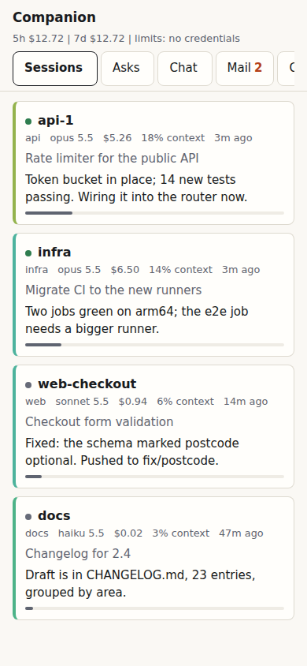
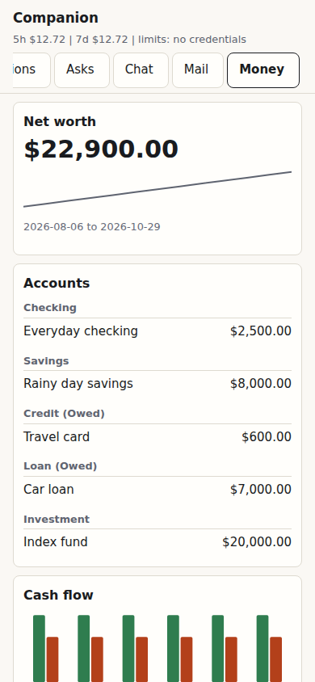
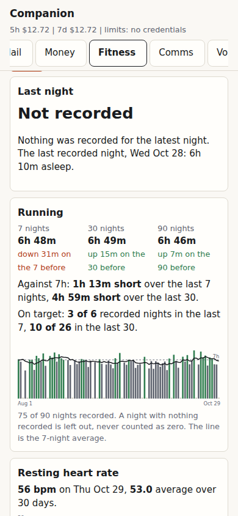
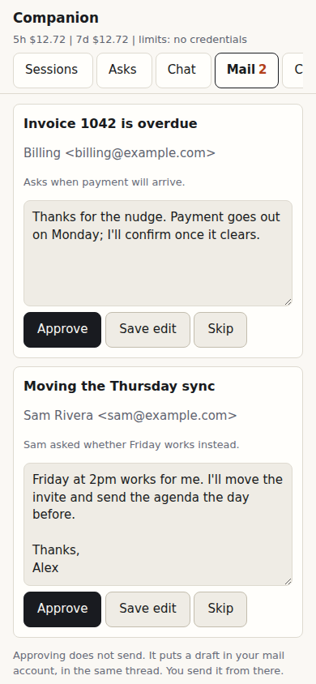
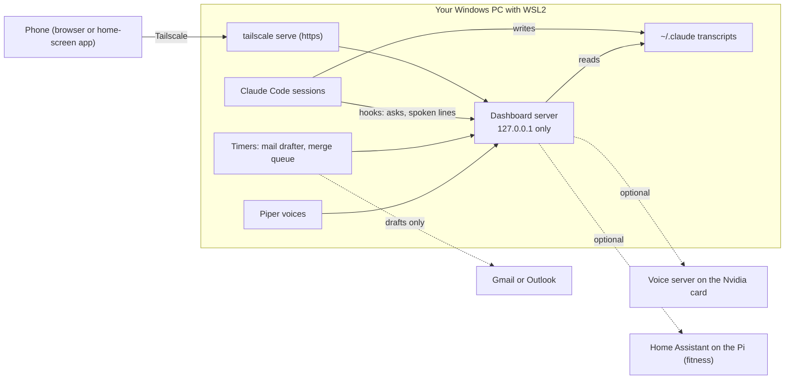
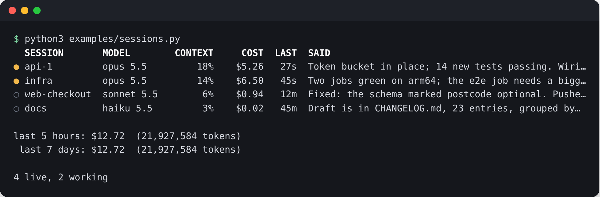

<h1 align="center">claude-companion</h1>

<p align="center">
  <b>A phone-first dashboard for your Claude Code sessions, and a few helpers that run on your own PC.</b><br>
  See which sessions are running, what they cost, which one is waiting on you, and answer from your pocket.
</p>

<p align="center">
  
  
  
  
</p>

Run four or five Claude Code sessions at once and the questions pile up. Which
one is stuck on a permission prompt? Which one is nearly out of context? What
did today cost? claude-companion answers them on one page you can open on your
phone. Around that page sit a few helpers that run on your own computer: a
mail drafter, spoken replies, a place to make voices, and notes between two
people's Claudes.

It is not a cloud service. There is no account, no server of ours, and no
telemetry. It runs on your PC and talks to your phone over your own Tailscale.
Most of its interaction with `~/.claude` is read-only, but optional hooks and
the local usage cache write there. Those writes, and every optional outbound
connection, are listed below.

<p align="center">
  
  
  
  
</p>
<p align="center"><sub>Phone width, 390 px. Every name and number is made up. More in <code>docs/images/</code>.</sub></p>

**Setting it up?** Hand [INSTALL.md](INSTALL.md) to your own Claude Code. It is
written for Windows with WSL2 and Ubuntu, and separates the core path from
optional services.

## What it does

The tabs, in the order they sit on the page. Turn any of them off with the
`features` setting.

**Sessions.** One card per live Claude Code session: model, cost, how full its
context is, the git branch, and its last reply. A session that is waiting on
you says so. Set a context line to flag a top-level session that needs
`/clear` and receive one push notification on each crossing. At the top, your
5-hour and 7-day spend and your real limits.

**Asks.** When a session wants permission to run something, or asks you a
multiple-choice question, it shows up here with Allow and Deny. If the command
was long and got shortened, the page makes you open the full text before it
lets you allow it. Ignore it and the session's own prompt still appears.

**Chat.** Type to any running session from your phone. Your words go into that
session's terminal pane, as if from the keyboard. Every send is guarded and
logged.

**Mail.** A helper reads new mail and writes replies in your voice for you to
approve. Approving makes a draft in your own mail account. You press send
yourself, because the code has no way to send. Gmail works through the Gmail
connector in claude.ai; Outlook is a one-file plug-in, with a guide in
[docs/mail-outlook.md](docs/mail-outlook.md).

**Money.** An outline of accounts, net worth, cash flow, spending by category
and recurring bills. It ships with a labelled DEMO household so you can see it
first. Real bank feeds (SimpleFIN, a CSV export or Plaid) come later, as one
file you have Claude write. See [docs/money-sources.md](docs/money-sources.md).
Read only; it cannot move money.

**Fitness.** Sleep, resting heart rate, steps, distance and weight over time.
Home Assistant is the optional source (it holds Fitbit, Garmin, Withings and
others); other sources plug in the same way, and a DEMO source is built in.
A night with no data is left out, never counted as zero. See
[docs/fitness-sources.md](docs/fitness-sources.md).

**Comms.** Your sessions talk. Each reply ends with one short line that is
spoken, rendered on your PC with Piper and played on your phone while the page
is open. Hold and volume are on the Settings page. See
[comms/README.md](comms/README.md).

**Voice lab.** Make a voice from clips of someone who has agreed to it, on your
Nvidia card (GPT-SoVITS, inside WSL2), then use it in comms. The tab shows
what you have built. Training happens in the shell, not on the page. See
[voicelab/README.md](voicelab/README.md).

**Connections.** One honest row per thing that could be wired up (hooks, Piper,
mail, Tailscale, voice server, and so on): ok, off, or broken, with one
sentence on how to fix it. Recheck re-runs the probes.

**Settings.** Shows what the app is running with and the line to change each
setting. The page itself changes the context line, comms (hold, volume, a test
clip), and removes a paired device. It never writes your config file.

**Push.** Notifications to your own phone when a session needs you, through the
browser's own Web Push, encrypted end to end. Add the page to your home screen
first (on iPhone this is required).

**Claude-to-Claude notes.** If two people's Claudes work on one repo, they leave
each other notes as GitHub issues, and code goes by pull request. Notes are
information, never orders. See [COLLAB.md](COLLAB.md).

**The merge queue.** Work lands as pull requests that you approve rather than
as pushes to main. This part is being added on another branch.

## How it fits together



## Local writes

Your Claude Code sessions and transcripts remain in `~/.claude`. By default,
claude-companion reads them. It writes the following there only when the
corresponding feature is used:

- The Sessions tab writes `~/.claude/usage-cache.json` and
  `~/.claude/limits-cache.json` unless `data_dir` is configured. They are local
  caches for token totals and limit checks.
- The standalone `notify` hook writes a waiting marker at
  `~/.claude/session-companion-waiting/<pid>`. If that hook sends Web Push, it
  can also create `session-companion-vapid.json` and
  `session-companion-push.json` there.
- `python -m claude_companion.server.install_hooks` adds its asks hooks to
  `~/.claude/settings.json` and first writes a timestamped
  `~/.claude/settings.json.bak-...` backup. Its `--uninstall` option removes
  only those asks hooks and also backs up the settings file when it changes it.
- `comms/install.sh` adds its Stop, SessionStart, and UserPromptSubmit hooks to
  `~/.claude/settings.json` and first writes a timestamped backup. It also
  registers the `tts` MCP server with `claude mcp add tts --scope user`; Claude
  Code keeps that user-scope registration in its own user configuration,
  normally `~/.claude.json` beside the `~/.claude` directory.
- `python -m claude_companion.collab install` is another optional hook setup.
  It adds its SessionStart hook to `~/.claude/settings.json` with a timestamped
  backup.

The app's own asks, mail queue, clips, voices, paired-device hashes, and other
state live in `~/.local/share/claude-companion/` and
`~/.config/claude-companion/`. The phone keeps its owner key in browser local
storage.

## Outbound connections

No outbound service is required for the local dashboard. These connections are
made only when their matching feature is enabled or configured:

| Service | When it can be contacted |
|---|---|
| Anthropic usage endpoint | When the dashboard refreshes real Claude Code usage limits and a local Claude Code login can supply the needed token. |
| GitHub | `gh` contacts GitHub for the optional merge queue and collaboration notes. The Comms installer also downloads the pinned Piper archive from GitHub. |
| Hugging Face | The Comms installer downloads the selected Piper voice files. |
| Gmail | The optional mail drafter runs Claude Code with the Gmail connector after mail is configured. |
| Outlook | Only an Outlook plug-in that you add and configure can contact Microsoft services. |
| Home Assistant | The fitness source contacts the configured Home Assistant URL. |
| Browser Web Push | A subscribed browser's push endpoint is contacted when Web Push is enabled. |
| Firebase Cloud Messaging | The optional Android delivery path contacts FCM only with `fcm_service_account_file` configured and a registered device. |
| Voice server | Comms contacts the configured custom voice server only for a `server:<name>` voice. |
| Gemini Live | The Live Call button and routes are enabled only when `gemini_key_file` is set. The browser sends microphone audio and selected session text to Google for that call. |

## Safety, in short

The full list, with the reasons, is in [CLAUDE.md](CLAUDE.md).

- **Mail never sends.** There is no send, reply or forward code, and a test fails if one appears.
- **Writes need a paired device.** An approval needs your phone's key, a JSON request and the page's own address, all three. The token the permission hook uses can approve nothing.
- **Loopback only.** The server listens on `127.0.0.1`. Your phone reaches it through `tailscale serve`; the port is never opened to the network.
- **Nothing personal in the repo.** Examples use made-up names, and a test scans for real-looking addresses, tailnet names and keys.
- **Voices need consent.** Only stock Piper voices ship. A custom voice is for someone who has agreed.
- **The honest limit.** A session running in bypass-permissions mode on your account can do anything you can, including reading the hook token or pairing itself. The walls stop a session that is waiting on a prompt from approving itself through this server. Where asks matter, do not run sessions in bypass mode.

## Getting started

1. Follow [INSTALL.md](INSTALL.md) on Windows with WSL2 and Ubuntu.
2. Install the server and pair a browser before enabling extras.
3. Add Tailscale, hooks, mail, comms, or other optional pieces one at a time.

Just want to look? `python3 -m pip install -e '.[app,push]'`, then
`python3 -m claude_companion.server` and open `http://127.0.0.1:8770/`, or run
`python3 examples/demo_home.py /tmp/demo` to build a made-up `~/.claude` first.

## Status

Version 0.1. Tested: the library, the server routes and the pages at phone
width, the mail drafter against a fake source, the comms scripts against a
fake Piper, and the leak scan (`python3 -m pytest -q`).

Not yet run on a real install: Gmail drafting live, Tailscale to a real phone,
voice training on a fresh machine, and the Outlook plug-in (a guide, no code
yet). Expect rough edges there, and tell your Claude when you hit one.

Roadmap: more connectors as plug-ins, and macOS.

## For developers: the library

The dashboard sits on a small library with no dependencies. It works alone,
without the server. If you are changing the code, read [CLAUDE.md](CLAUDE.md)
first.

### Quick start



```bash
git clone https://github.com/trivgar/claude-companion
cd claude-companion
python3 -m pip install -e .

python3 examples/sessions.py                     # your own sessions
```

No sessions running, or want to look first? Build a made-up `~/.claude`:

```bash
python3 examples/demo_home.py /tmp/demo           # four fake sessions
python3 examples/sessions.py --home /tmp/demo/.claude
```

Python 3.11 or newer. For Web Push: `python3 -m pip install -e '.[push]'`.

### What it reads

| Source | What comes out |
|---|---|
| `~/.claude/sessions/*.json` | Live sessions: pid, project, name, who started it (you, another session, a background job) |
| `~/.claude/projects/**/*.jsonl` | Each session's model, tokens, cost, context fill, last prompt and reply, its helper agents and workflows |
| `/proc` | Which of those processes are really alive (the registry keeps dead ones) |
| `git` in each session's repo | Branch, ahead/behind, uncommitted files. Read only: it never takes `index.lock` |
| Anthropic's usage endpoint | Your real 5-hour and 7-day limit use, when optional limit refresh is available |

Transcripts are read incrementally by byte offset, so a 75 MB transcript costs
a few kilobytes per poll.

### Use it in code

```python
from pathlib import Path
from claude_companion.reader import SessionReader
from claude_companion.usage import UsageIndex

home = Path.home() / ".claude"

for s in SessionReader(home).snapshot():
    print(s["project"], s["status"], s["model"], f'${s["cost_usd"]:.2f}', f'{s["context_pct"]}% context')

usage = UsageIndex(home)
usage.refresh()            # reads only what is new since the last call
print(usage.snapshot())    # tokens and cost in the 5-hour and 7-day windows
```

Each session row also carries `waiting` (blocked on a question or a
permission), `last_reply`, `subagents`, `parent_pid` and `job` (for helpers and
background runs), and `tokens` by type.

| Module | What it does |
|---|---|
| `registry` | The live session registry, with dead entries dropped |
| `reader` | One row per session, everything above joined up |
| `transcript` | The incremental transcript reader |
| `usage`, `pricing` | Tokens and cost over the 5-hour, 7-day and lifetime windows; prices per model from Anthropic's published rates |
| `limits` | Real limit use from Anthropic's OAuth usage endpoint |
| `activity`, `tasks` | What an agent has been doing: tool calls, time spent, workflows and helpers |
| `gitstate`, `changes` | Each repo's branch, ahead/behind, and unpushed work |
| `messages` | Messages sessions send each other (SendMessage) |
| `notify` | A permission and question hook that marks the session waiting and speaks or pushes one line |
| `webpush` | Web Push to your own devices, VAPID keys kept locally |

An unknown model is counted as **unpriced**, never as free: the lifetime
figure says how many tokens it could not price.

### The permission hook

`notify` turns Claude Code's `PermissionRequest` hook into one short line,
"A session needs your OK on this: Bash, npm test", so a blocked session does not sit
there looking idle. Add it to `~/.claude/settings.json`:

```json
{
  "hooks": {
    "PermissionRequest": [
      {"matcher": ".*", "hooks": [{"type": "command", "command": "python3 -m claude_companion.notify", "timeout": 2}]}
    ]
  }
}
```

It never blocks and never fails the session: every error path exits 0. Speech
is optional. By default it uses the bundled `comms/speak.sh` coordinator. Set
`tts_dir` to an AgentVibes-compatible directory containing an executable
`speak.sh` to override it; push is optional too, with the `push` extra installed
and a device subscribed.

### Library settings

In `~/.config/claude-companion/config.toml`, or as `CLAUDE_COMPANION_<KEY>`
in the environment, which wins. A file as well as the environment, because
hooks run outside any server's process.

| Key | What it does |
|---|---|
| `name` | What spoken lines call you. Blank leaves the address out. |
| `url` | The address a push opens. Web Push needs https, e.g. a `tailscale serve` URL. Default `http://127.0.0.1:8770` |
| `contact` | `mailto:` address push services can reach you at |
| `icons` | A module with `icon_data(tag, title)` and `icon_for(tag, title)` for each push's picture (optional) |
| `archive_roots` | Old transcript trees to count in the lifetime total (a list; `:`-separated in the environment) |
| `tts_dir` | Directory containing an executable speech coordinator `speak.sh`; optional and compatible with AgentVibes-style coordinators |

### Helpers and background jobs

Each session row says who started it. `parent_pid` is the nearest live
session above it in the process tree (a helper a session ran), `root_pid` the
top of that chain, and `child` is true for both. A background run started
detached (`setsid`, a timer) has no session above it, so it says so in its
own environment instead:

| Variable | Row field |
|---|---|
| `CLAUDE_COMPANION_JOB=<word>` | `job`, and `child` is true |
| `CLAUDE_COMPANION_ABOUT=<name>` | `job_about`: whose work the job is about |
| `CLAUDE_TTS_SILENT=1` alone | `job` reads `headless` |

Only those names are read from `/proc/<pid>/environ`, once per process, and
only for a session with no session above it. Nothing else in the environment
is kept.

Each item in `subagents` (an Agent-tool helper that wrote in the last 90 s)
carries `label` (its first prompt line, cut to a chip), `ago`, `status`
(`busy` when it wrote in the last 30 s), `cost_usd` and `started_at`.

### Privacy

The local dashboard works without an external service. See
[Outbound connections](#outbound-connections) for the optional services it can
contact. A folder can be marked private (`SessionReader(home, hide=...)`): its
sessions are never listed or read, and can show as presence only ("someone's
agent, working").

## Uninstall

Run these commands from the repository root to remove the optional Claude Code
integrations without changing unrelated hooks:

```bash
# Asks hooks installed by install_hooks.py
.venv/bin/python -m claude_companion.server.install_hooks --uninstall

# Comms hooks and its user-scope tts MCP registration
comms/install.sh --uninstall

# Collaboration notes SessionStart hook, if installed
.venv/bin/python -m claude_companion.collab uninstall
```

Each command leaves existing timestamped `settings.json` backups in place for
review. If you manually added the standalone `notify` hook, remove only its
`python3 -m claude_companion.notify` entry from the `PermissionRequest` hooks
in `~/.claude/settings.json`.

### Tests

```bash
python3 -m pip install -e '.[app,push,test]'
python3 -m pytest -q
```

Every test builds its own temporary `~/.claude`; none reads yours.

## License

MIT. See `LICENSE`.
